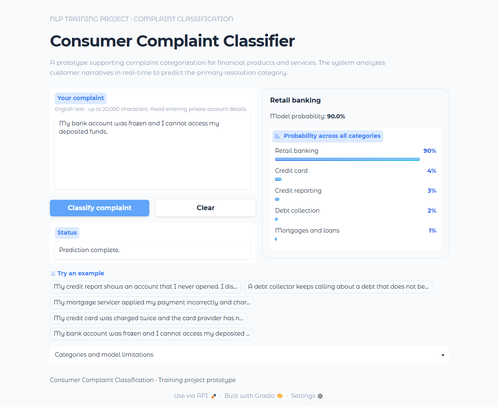

# Consumer Complaint Classification

Classify English financial complaint narratives into five product categories. This training project compares custom SimpleRNN, LSTM and GRU classifiers with a fine-tuned DistilBERT. DistilBERT was selected using validation macro F1 before the held-out test evaluation.

## Explore the project

- [Presentation notebook](notebooks/consumer_complaint_classification.ipynb): readable walkthrough, saved results and eight charts. Running its default cells rebuilds the analysis without downloading data or training models.
- [HTML reading copy](notebooks/consumer_complaint_classification.html): exported presentation notebook; download and open locally.
- [Training notebook](notebooks/consumer_complaint_training.ipynb): self-contained Kaggle workflow for source acquisition, preparation, four-model training, evaluation and export. Saved outputs document the original completed experiment; maintained source changes have not undergone another full GPU run.
- [Experiment configuration](configs/experiment.json) and [preparation reference](configs/reference.json): the canonical configuration and reference fingerprints.
- [Published Hugging Face model](https://huggingface.co/Solayman-Sameh/consumer-complaint-classifier).

## Demo

[](docs/media/consumer-complaint-classifier-demo.mp4)

[Watch the 25-second demonstration](docs/media/consumer-complaint-classifier-demo.mp4). Both the preview screenshot and video are included in this repository. The screenshot reflects the current interface in `app.py`; the video shows the interface prior to minor wording adjustments.

## Results

All models use the same 99,182 training / 12,398 validation / 12,398 test records.

| Model | Parameters | Validation macro F1 | Test accuracy | Test macro F1 | Test weighted loss |
|---|---:|---:|---:|---:|---:|
| DistilBERT (selected) | 66,957,317 | 0.8428 | 85.43% | 0.8467 | 0.4215 |
| GRU | 3,939,717 | 0.8316 | 84.14% | 0.8263 | 0.5417 |
| LSTM | 3,972,741 | 0.8294 | 83.74% | 0.8231 | 0.5257 |
| SimpleRNN | 3,873,669 | 0.7318 | 74.72% | 0.7263 | 0.7839 |

DistilBERT improved test macro F1 by 2.04 percentage points over GRU in this single-seed experiment. This compares complete modeling pipelines, including pretrained representations and different tokenization.

[Validation comparison](reports/validation_comparison.csv) · [Test comparison](reports/final_test/test_comparison.csv) · [Frozen selection](reports/selection.json)

`reports/models/` contains training histories, validation predictions, metrics and learning curves. `reports/final_test/` includes complete test predictions/probabilities, per-class precision/recall/F1 and raw/normalized confusion matrices for every model. `reports/preparation_reports/` records exclusions, class counts, row assignments and split checks.

CPU latency depends on input length and hardware. [Matched CPU measurements](reports/cpu_model_comparison.json) use identical short/long texts, two CPU threads, batch size one, three warmups and 30 calls per stratum, including preprocessing and inference. Historical per-model GPU timings exclude tokenization and are separate measurements.

## Dataset and preprocessing

Source: [Consumer Complaints Dataset for NLP, version 1](https://www.kaggle.com/datasets/shashwatwork/consume-complaints-dataset-fo-nlp), as linked by the training assignment. The CSV contains 162,421 rows with `product` and `narrative`; auditing and deduplication retain 123,978.

| Category | Retained records |
|---|---:|
| Credit reporting | 55,891 |
| Debt collection | 20,971 |
| Mortgages and loans | 18,698 |
| Credit card | 14,958 |
| Retail banking | 13,460 |

The source text was already processed upstream; raw narratives and the full upstream cleaning history are unavailable. Stratified grouped folds (seed 42) keep identical normalized, cleaned and encoded inputs within one split. Semantic near-duplicates may remain.

- Recurrent models: NFKC normalization, case folding, non-letter removal, fixed stop-word removal with negations preserved; a training-only 30,000-entry vocabulary; a 256-word cap; learned 128-dimensional embeddings; one unidirectional recurrent layer; packed sequences to exclude padding from the final hidden state.
- DistilBERT: normalized source text, pretrained WordPiece tokenization, a 256-token cap and attention masks. The encoder and classification head were fine-tuned.
- All models: training-derived class-weighted cross-entropy; checkpoint/model selection by validation macro F1. Test outcomes do not change the winner.

## Run locally

Python 3.11 is supported for the application. The recorded Kaggle training environment used Python 3.13; see [training environment](reports/environment.json).

```powershell
git clone https://github.com/Solayman-Sameh/consumer-complaint-classification.git
cd consumer-complaint-classification
py -3.11 -m venv .venv
.\.venv\Scripts\Activate.ps1
python -m pip install -r requirements.txt
python scripts/download_model.py
python app.py
```

On macOS/Linux, create the environment with `python3.11 -m venv .venv` and activate with `source .venv/bin/activate`; the remaining Python commands are the same. In Windows CMD, activate with `.venv\Scripts\activate.bat`.

Open [the local application](http://127.0.0.1:7860). On this laptop, the existing `.venv-app` environment and local weights can be reused; installation/download is unnecessary if they are already present.

For another port, use `$env:PORT = "7861"` in PowerShell, `set PORT=7861` in CMD, or `PORT=7861 python app.py` on macOS/Linux. `GRADIO_SERVER_PORT` is also supported; `PORT` takes precedence.

With the server running, activate the environment in a second terminal:

```bash
python scripts/verify_app.py
python scripts/verify_app.py --fixture-only
```

Set `APP_TEST_URL` to the server URL when using another port. Verification checks the five expected demo categories, invalid inputs, reload consistency, API responses and truncation notices. It does not measure probability calibration. Results are written to [application verification](reports/application_verification.json).

## Use the published model directly

```python
import unicodedata
import torch
from transformers import AutoModelForSequenceClassification, AutoTokenizer

repo = "Solayman-Sameh/consumer-complaint-classifier"
model = AutoModelForSequenceClassification.from_pretrained(repo).eval()
tokenizer = AutoTokenizer.from_pretrained(repo)
text = "My bank froze my checking account and I cannot access my money."
text = " ".join(unicodedata.normalize("NFKC", text).casefold().split())
inputs = tokenizer(text, truncation=True, max_length=256, return_tensors="pt")
with torch.inference_mode():
    probabilities = model(**inputs).logits.softmax(dim=-1)[0]
label_id = int(probabilities.argmax())
print(model.config.id2label[label_id], float(probabilities[label_id]))
```

The model and tokenizer load from the public repository. [Hugging Face verification](reports/huggingface_verification.json) records the tested revision, matching weight checksum and prediction comparison. The GitHub repository excludes the 267.8 MB model weights; the local directory retains them. The downloader verifies the published file against `deployment_model/bundle.json`.

## Reproduce training and maintain the notebooks

Upload `notebooks/consumer_complaint_training.ipynb` to Kaggle. Enable Internet and GPU T4 x2, and run from the top. The notebook embeds the implementation and canonical configuration, acquires the pinned source, verifies preparation, trains four models in independent GPU workers, freezes validation selection and evaluates the held-out test set. A new source signature requires a new experiment output directory. Historical outputs remain evidence of the original run, not proof of rerunning later source edits.

For local source maintenance:

```bash
python scripts/sync_training_notebook.py
python scripts/sync_training_notebook.py --check
python scripts/build_submission_notebook.py
python scripts/execute_submission_notebook.py
```

The last two commands require `nbformat`, `nbconvert`, `ipython`, `matplotlib-inline` and the analysis dependencies. They regenerate the presentation notebook and HTML, not the trained models. `python scripts/verify_release.py` additionally checks all four real bundle interfaces; it requires the locally retained recurrent checkpoints. `python scripts/benchmark_cpu_models.py` regenerates the CPU comparison. `scripts/verify_huggingface.py` checks the published model online.

## Directory guide

```text
app.py                 Local Gradio application
configs/               Canonical experiment.json and reference.json
notebooks/             Presentation notebook, HTML and training notebook
src/complaints/        Preparation, modeling, training, evaluation and inference
scripts/               Downloads, verification and notebook maintenance
reports/               Original experiment evidence and current verification
artifacts/             Checkpoint manifest; recurrent checkpoints kept locally
deployment_model/      Tokenizer, labels, preprocessing, integrity manifest and local weights
docs/media/            Demo video and preview
```

The full source directory is the project. No ZIP is needed for GitHub. Environments, temporary checks and large trained weights are excluded from Git; notebooks, configurations, reports and demo media are included. Optional Space deployment uses `scripts/deploy_space.py`, `requirements-space.txt` and `docs/EXPORTED_APP_README.md`; a Hugging Face model repository is not itself a hosted Gradio app.

## Limitations

English, five-category classification only. Unrelated or non-English text still receives a category. Scores are uncalibrated; long complaints are truncated. Source preprocessing differs from naturally written complaints. The held-out accuracy does not establish production routing accuracy, business savings or a service guarantee.

## Licence

Original project software is covered by the [MIT licence](LICENSE). Third-party dataset and pretrained-model terms remain separate.
